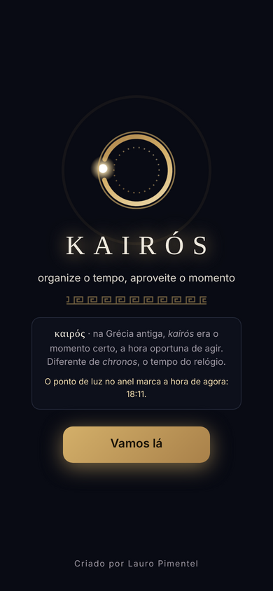
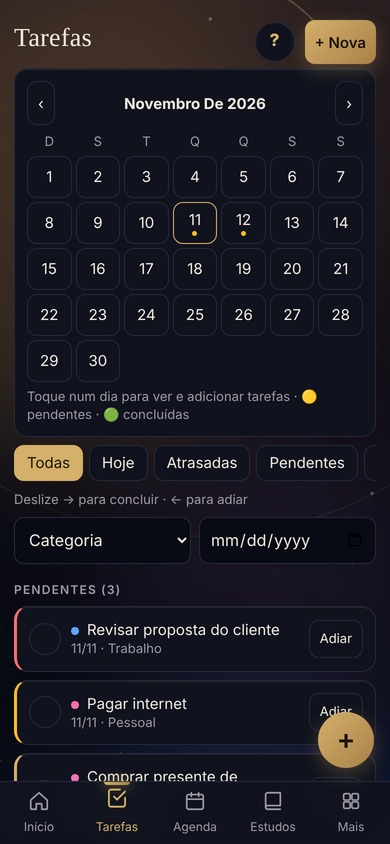
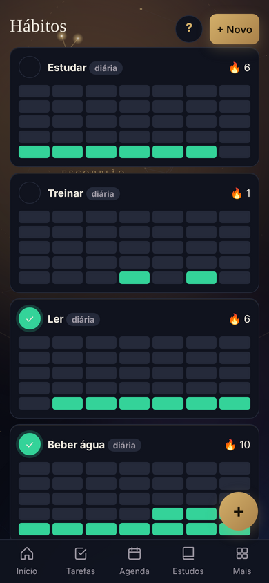
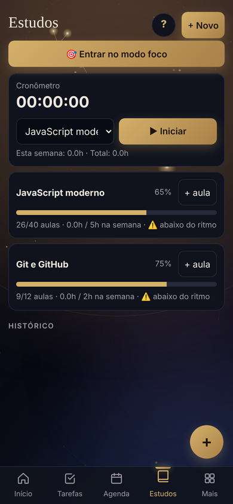

# Kairós

> *καιρός* · na Grécia antiga, **kairós** era o momento certo, a hora oportuna de agir. Diferente de *chronos*, o tempo do relógio.

App pessoal de organização para celular. Junta num só lugar tarefas, agenda, rotina, estudos, hábitos, metas, contas e treinos, com a corujinha **Glau** explicando cada tela.

**[Abrir o app](https://lauropimentel24-gb.github.io/kairos/)**

  

## Telas

| Abertura | Início | Tarefas | Hábitos | Estudos |
|:---:|:---:|:---:|:---:|:---:|
|  |  |  |  |  |

*Imagens com dados de exemplo.*

## Funcionalidades

- **Hoje:** checklist do dia, próximo compromisso, top 3 tarefas sugeridas e hábitos do dia.
- **Tarefas e agenda:** compromissos e pendências organizados por dia.
- **Rotina e Modo foco:** monte sua rotina e trabalhe em blocos de concentração.
- **Estudos, hábitos e metas:** acompanhe o progresso de cada um.
- **Contas a pagar e treinos:** controle de vencimentos e registro de treinos.
- **Anotações, fechamento do dia e relatórios:** revise o que foi feito.
- **Conquistas:** marcos desbloqueados conforme você usa o app.
- **Compartilhar:** envie o resumo do dia pelo WhatsApp ou exporte em PDF e CSV.
- **Backup:** exporte e importe seus dados em JSON.
- **Ajuda integrada:** a Glau explica cada tela, com tour guiado e botão **?** em todas as telas.
- **Aparência:** tema claro e escuro, texto grande e fundo animado, que pausa quando o app fica em segundo plano.

## Tecnologias

HTML, CSS e JavaScript puros, sem framework e sem etapa de build. Todo o app, incluindo as animações (CSS e canvas), está no `index.html`. PDF gerado com [jsPDF](https://github.com/parallax/jsPDF).

É um **PWA**: `manifest.webmanifest` e os ícones permitem instalar na tela inicial como app, e o `service-worker.js` guarda uma cópia para abrir mesmo sem internet.

## Seus dados

Tudo fica salvo no `localStorage` do navegador do aparelho. Nada é enviado para servidor. Por isso:

- Limpar os dados do navegador apaga tudo, então use o backup em JSON com frequência.
- Os dados de um aparelho não aparecem em outro.

## Como usar

1. Abra o link acima no celular.
2. Adicione à tela inicial. **iPhone:** Safari, depois Compartilhar e *Adicionar à Tela de Início*. **Android:** Chrome, depois menu e *Adicionar à tela inicial*.
3. Diga seu nome e siga o tour com a Glau.

Para rodar localmente, clone o repositório e rode `python -m http.server 8000` na pasta. Abrir o `index.html` direto também funciona, mas sem instalação e sem modo offline.

## Autor

Criado por [Lauro Pimentel](https://github.com/lauropimentel24-gb).

## Licença

[MIT](LICENSE)
